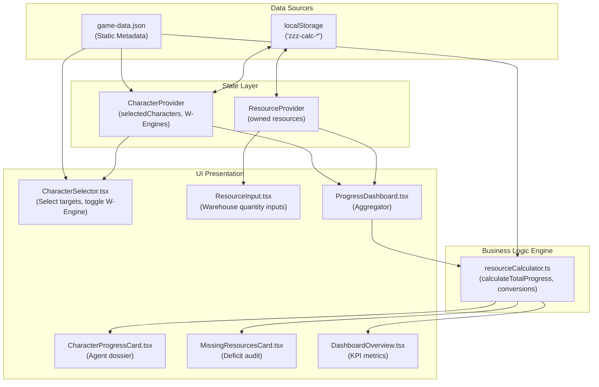

# AGENTS.md — ZZZ Calc Repository Guide

Welcome, Agent. This document is the primary architectural and operational guide for AI coding assistants working in the **ZZZ Calc** (`zzz-calc`) repository.

---

### Project Scope and Development Philosophy

This is a personal, single-user pet project.

Development priorities:
- Practical functionality over enterprise-grade architecture.
- Minimal maintenance overhead.
- Avoid unnecessary abstractions and infrastructure.
- No backend, authentication, database or cloud synchronization.
- No automated testing framework is desired.
- Do not introduce automated tests, test dependencies or temporary test scripts.
- Avoid spending excessive effort on testing infrastructure or elaborate validation workflows.

Prefer straightforward, maintainable solutions appropriate for a personal project.

---

## 1. Project Overview

- **Purpose**: A Zenless Zone Zero (ZZZ) progression calculator and resource auditor. It calculates material requirements, promotion readiness, and inventory deficits for agent levels (up to level 60) and optional W-Engine equipment.
- **Visual Identity**: In-universe proxy management terminal aesthetic, high-contrast dark graphite palette (`#111214`, `#1A1B20`), signature ZZZ orange (`#FF6B35`) and yellow (`#F5E642`) accents, industrial chamfers, caution hazard patterns, and editorial typography (`Chakra Petch`).
- **Target Platform**: Single Page Application (SPA), desktop-first responsive design down to mobile widths.
- **Client-Side Only**: 100% offline-first application. There is **no backend server, no database, no authentication layer, and no cloud synchronization**.
- **State Persistence**: Browser `window.localStorage`.
- **Primary Tech Stack**:
  - React 19.3.1
  - TypeScript 6.0.3 (strict mode with project references `tsc -b`)
  - Vite 5.4.21
  - Tailwind CSS 3.4.0 (custom design tokens loaded from [`src/styles/tokens.css`](src/styles/tokens.css))
  - `lucide-react` 1.61.0 (system iconography)

---

## 2. Repository Structure

```text
zzz-calc/
├── docs/
│   ├── ZZZ-CALC-DESIGN-BRIEF.md      # UI/UX redesign specifications and token definitions
│   ├── audit1.md                     # Initial architectural and code audit
│   └── phase-1.md                    # Implementation roadmap notes
├── src/
│   ├── assets/                       # Static game assets
│   │   └── images/
│   │       ├── char_portrait/        # 64 Character portrait PNGs (<id>.png)
│   │       ├── class_elements/       # WebP badges for 7 classes and 7 elements
│   │       └── materials/            # PNG and WebP icons for seals, chips, logs, and components
│   ├── components/
│   │   ├── character-selector/
│   │   │   └── CharacterSelector.tsx # Agent directory with text search, class pills, and selection state
│   │   ├── layout/
│   │   │   ├── Header.tsx            # Terminal header with reset dialog and status counters
│   │   │   └── Layout.tsx            # Root container, accent lines, and footer watermark
│   │   ├── progress-dashboard/
│   │   │   ├── DashboardOverview.tsx # KPI summary bar (active targets, deficit count, overall readiness)
│   │   │   ├── CharacterProgressCard.tsx # Agent dossier card with 9 resource progress bars and W-Engine switch
│   │   │   ├── MissingResourcesCard.tsx  # Categorized shortage audit with material icons
│   │   │   └── ProgressDashboard.tsx     # Coordinator component; handles aggregation and empty standby state
│   │   ├── resource-input/
│   │   │   └── ResourceInput.tsx     # Warehouse terminal with categorized tabs (General, Seals, Chips, W-Engine)
│   │   ├── ui/                       # Reusable design primitives
│   │   │   ├── Badge.tsx             # ZZZ status and classification badge
│   │   │   ├── Button.tsx            # Angular button with primary, secondary, danger, and ghost variants
│   │   │   ├── ConfirmDialog.tsx     # Accessible modal dialog for destructive actions
│   │   │   ├── Panel.tsx             # Framed terminal surface with header bar
│   │   │   └── ProgressBar.tsx       # Industrial progress bar with color-coded thresholds
│   │   └── MaterialIcon.tsx          # Universal icon renderer with image error fallback
│   ├── contexts/
│   │   ├── characterContextDef.ts    # CharacterContext definition and interface (Fast Refresh compliant)
│   │   ├── CharacterContext.tsx      # CharacterProvider implementation only
│   │   ├── resourceContextDef.ts     # ResourceContext definition and interface (Fast Refresh compliant)
│   │   └── ResourceContext.tsx       # ResourceProvider implementation only
│   ├── data/
│   │   └── game-data.json            # Authoritative static game data (classes, elements, requirements, characters)
│   ├── hooks/
│   │   ├── useCharacters.ts          # Consumer hook for CharacterContext
│   │   └── useResources.ts           # Consumer hook for ResourceContext
│   ├── lib/
│   │   ├── localStorage.ts           # Type-safe wrapper around window.localStorage with error handling
│   │   ├── materialIcons.ts          # MATERIAL_ICONS dictionary and typed accessor helpers
│   │   └── resourceCalculator.ts     # Pure mathematical calculation engine for progression and shortages
│   ├── styles/
│   │   └── tokens.css                # CSS variables, clip-paths (.zzz-cut-corner-br), caution stripes
│   ├── types/
│   │   └── index.ts                  # Domain models, calculation contracts, and resource schemas
│   ├── App.tsx                       # Root layout assembly and provider orchestration
│   ├── index.css                     # Tailwind directives, font imports, and base styles
│   └── main.tsx                      # Vite React entry point
├── eslint.config.js                  # Flat ESLint config with react-refresh and typescript-eslint
├── index.html                        # HTML entry point, Google Fonts preconnect (Chakra Petch, Inter)
├── package.json                      # Scripts and dependencies
├── tailwind.config.js                # Tailwind theme extensions mapping to CSS tokens
├── todo.md                           # Backlog checklist
└── tsconfig.json / tsconfig.app.json # TypeScript strict project configuration
```

---

## 3. Architecture and Data Flow

### 3.1 Application Initialization
1. [`index.html`](index.html) loads Google Fonts (`Chakra Petch` and `Inter`) and mounts [`src/main.tsx`](src/main.tsx).
2. [`src/main.tsx`](src/main.tsx) renders `<App />` inside React `<StrictMode>`.
3. [`src/App.tsx`](src/App.tsx) wraps the app hierarchy in `<CharacterProvider>` and `<ResourceProvider>`, rendering the `<Layout>` shell.

### 3.2 State Management and Fast Refresh Architecture
> [!IMPORTANT]
> The codebase enforces strict compliance with Vite's `react-refresh/only-export-components` rule. **Never export hooks, context objects, or functions from a `.tsx` file that exports a React component.**

The decoupled architecture:
1. **Context Definitions (`.ts`)**:
   - [`src/contexts/characterContextDef.ts`](src/contexts/characterContextDef.ts): Declares `CharacterContextType` and creates `CharacterContext`.
   - [`src/contexts/resourceContextDef.ts`](src/contexts/resourceContextDef.ts): Declares `ResourceContextType`, `initialResources`, and creates `ResourceContext`.
2. **Provider Components (`.tsx`)**:
   - [`src/contexts/CharacterContext.tsx`](src/contexts/CharacterContext.tsx): Manages `selectedCharacters` and `charactersWithWEngine`, auto-syncing to `localStorage`. Exports **only** `CharacterProvider`.
   - [`src/contexts/ResourceContext.tsx`](src/contexts/ResourceContext.tsx): Manages `resources` state and mutators (`updateDennies`, `updateSeals`, etc.), auto-syncing to `localStorage`. Exports **only** `ResourceProvider`.
3. **Consumer Hooks (`src/hooks/`)**:
   - [`src/hooks/useCharacters.ts`](src/hooks/useCharacters.ts): Consumes `CharacterContext` and validates provider presence.
   - [`src/hooks/useResources.ts`](src/hooks/useResources.ts): Consumes `ResourceContext` and validates provider presence.

### 3.3 Storage Schema (`localStorage.ts`)
State is serialized into `window.localStorage` under three keys:
- `'zzz-calc-resources'`: Object conforming to interface `Resources`.
- `'zzz-calc-selected-characters'`: Array of character IDs (`string[]`).
- `'zzz-calc-w-engines'`: Array of character IDs with active W-Engine tracking (`string[]`).

### 3.4 Data Flow Diagram



---

## 4. Business Logic & Calculations

All domain formulas reside in [`src/lib/resourceCalculator.ts`](src/lib/resourceCalculator.ts).

### 4.1 Requirements Base Data ([`src/data/game-data.json`](src/data/game-data.json))
Baseline progression requirements per character (level 1 to 60):
- **EXP**: `900,000` total EXP per agent.
- **Dennies**: `3,700,000` Dennies per agent.
- **Certification Seals**: 4 Basic, 32 Advanced, 30 Top-Tier.
- **Tactical Chips**: 25 Basic, 75 Advanced, 250 Specialized.
- **Expert Challenge Materials**: 60 per agent.
- **Boss Materials**: 9 per agent.
- **Hamster Cage Pass**: 5 per agent.
- **W-Engine EXP** (optional): `600,000` total EXP per weapon.
- **W-Engine Ascension** (optional): 4 Basic, 32 Advanced, 30 Expert components.

### 4.2 Tier Conversion Logic (Fusion / Dismantling)
Materials within the same family can be synthesized up or dismantled down using a 1:3 ratio. Calculations translate all owned and required materials into "basic units" to determine true progression:

$$\text{Basic Units} = (\text{Basic} \times 1) + (\text{Advanced} \times 3) + (\text{Top/Specialized/Expert} \times 9)$$

- **Seals**: Calculated per class (`calculateSealsProgress`). Required units are scaled by the number of selected characters sharing that class:
  $$\text{Required Units} = (4 \times 1 + 32 \times 3 + 30 \times 9) \times N_{\text{class}} = 370 \times N_{\text{class}}$$
- **Chips**: Calculated per element (`calculateChipsProgress`). Required units are scaled by the number of selected characters sharing that element:
  $$\text{Required Units} = (25 \times 1 + 75 \times 3 + 250 \times 9) \times N_{\text{element}} = 2500 \times N_{\text{element}}$$
- **W-Engine Ascension**: Calculated per class (`calculateWEngineAscensionProgress`). Basic unit equivalent of 370 per active W-Engine.

### 4.3 EXP Value Conversions
- **Investigator Logs**:
  - Trainee Log = `100` EXP
  - Official Log = `600` EXP
  - Senior Log = `3,000` EXP
  - Progress: $(\sum \text{Log EXP}) / (900,000 \times N_{\text{selected}}) \times 100\%$
- **W-Engine Batteries**:
  - Basic = `100` EXP
  - Advanced = `600` EXP
  - Expert = `3,000` EXP
  - Progress: $(\sum \text{Battery EXP}) / (600,000 \times N_{\text{w-engine}}) \times 100\%$

### 4.4 Total Progress Formula
For each character dossier, `calculateTotalProgress()` computes the arithmetic mean of 9 resource categories:
$$\text{Total} = \frac{\text{EXP} + \text{Seals} + \text{Chips} + \text{Dennies} + \text{Expert} + \text{Boss} + \text{HamsterPass} + \text{WExp} + \text{WAscension}}{9}$$

> [!NOTE]
> If a character does **not** have W-Engine tracking active (`character.hasWEngine === false`), both `wEngineExp` and `wEngineAscension` default to `100%`, ensuring unequipped weapons do not penalize overall readiness.

---

## 5. Development Workflow

### Available Commands
The following commands are configured and functional:

| Command | Action |
|---|---|
| `npm install` | Installs project dependencies. |
| `npm run dev` | Launches the local Vite development server with HMR. |
| `npm run build` | Runs TypeScript compilation (`tsc -b`) followed by Vite production bundling. |
| `npm run lint` | Executes ESLint 10 over the repository (`eslint .`). |
| `npm run preview` | Spins up a local static server to inspect the `dist/` production build. |
| `start-app.bat` | Windows helper batch script that executes `npm run dev`. |

> [!WARNING]
> No automated test suite (Jest, Vitest, Cypress, Playwright) is configured in `package.json`. Do **not** invent or attempt to run `npm test`.

---

## 6. Coding Conventions

### 6.1 Naming Conventions
- **Components & Contexts**: `PascalCase` (e.g., `CharacterSelector.tsx`, `CharacterProvider`, `ResourceContext`).
- **Functions, Variables & Hooks**: `camelCase` (e.g., `calculateTotalProgress`, `useCharacters`, `updateDennies`).
- **Directories**: `kebab-case` under `src/components/` (e.g., `character-selector/`, `progress-dashboard/`, `resource-input/`).
- **Constants**: `UPPER_SNAKE_CASE` (e.g., `STORAGE_KEYS`, `MATERIAL_ICONS`).
- **CSS Utility Classes**: `kebab-case` with the project prefix `.zzz-*` (e.g., `.zzz-cut-corner-br`, `.zzz-focus-ring`).

### 6.2 TypeScript & Type Safety
- **Strict Typing**: Do not use `any` or loose type assertions (`as any`).
- **Domain Interfaces**: All models must be typed in [`src/types/index.ts`](src/types/index.ts).
- **Type-Safe Asset Indexing**: `MATERIAL_ICONS` in [`src/lib/materialIcons.ts`](src/lib/materialIcons.ts) is typed with `as const`. Direct bracket indexing with raw `string` (`MATERIAL_ICONS.classes[char.class]`) will trigger `TS7053`. Always use the exported helper accessors:
  - `getClassIcon(className: string)`
  - `getElementIcon(element: string)`
  - `getSealIcons(className: string)`
  - `getChipIcons(element: string)`
  - `getWEngineAscensionIcons(className: string)`
  - `getCharacterPortrait(characterId: string)`

### 6.3 Component & Hook Conventions
- **Component Placement**: Feature components live in named directories under `src/components/<feature>/`. Shared primitives live in `src/components/ui/`.
- **Fast Refresh Hygiene**: Context definitions belong in `.ts` files; provider components in `.tsx` files; consumer hooks in `src/hooks/`.
- **Icon Sizing**: Use `MaterialIcon` for game assets (`xs`: 16px, `sm`: 24px, `md`: 32px, `lg`: 48px). Use `lucide-react` for system glyphs.

### 6.4 Styling & Design Tokens
- Use the custom Tailwind `zzz` token namespace defined in [`tailwind.config.js`](tailwind.config.js):
  - Background: `bg-zzz-bg` (`#111214`), `bg-zzz-surface` (`#1A1B20`), `bg-zzz-surface-raised` (`#2F313A`)
  - Accents: `text-zzz-accent` / `bg-zzz-accent` (`#FF6B35`), `text-zzz-secondary` (`#F5E642`)
  - Status: `text-zzz-success` (`#77D6A0`), `text-zzz-danger` (`#FF646B`), `text-zzz-warning` (`#F5C451`)
  - Borders: `border-zzz-border-subtle`, `border-zzz-border`, `border-zzz-border-strong`
- Utilize geometric utility classes:
  - `.zzz-cut-corner-br`: Chamfered bottom-right corner.
  - `.zzz-chamfer-sm`: Chamfered badge frame.
  - `.zzz-stripes-hazard`: Caution diagonal stripes.
  - `.zzz-focus-ring`: High-contrast orange keyboard focus outline.
- Numbers and quantities must use `font-mono tabular-nums`.

### 6.5 Error Handling & Fallbacks
- **Local Storage (`localStorage.ts`)**: All read/write operations wrap `window.localStorage` calls in `try...catch` blocks, logging errors to `console.error` and gracefully returning `null` on parse failures.
- **Hook Boundary Safety**: `useCharacters` and `useResources` throw an explicit `Error` if invoked outside their respective Providers.
- **Asset Fallbacks (`MaterialIcon.tsx`)**: Missing or broken image URLs trigger an `onError` handler that sets opacity or displays a fallback glyph rather than breaking the layout.

---

## 7. Operational Guidelines for AI Agents

1. **Inspect Before Modifying**: Always read target files and trace their consumers before altering interfaces, calculations, or contexts.
2. **Trace Dependencies**: Before changing shared logic (e.g. calculation utilities or context signatures), inspect all consumer components.
3. **Preserve Application Behavior**: Do not rewrite working calculation algorithms or mutate `localStorage` keys without explicit instructions.
4. **Avoid Unnecessary Refactoring**: Keep changes focused and minimal. Do not rewrite code that is already working.
5. **Avoid Unjustified Dependencies**: Do not introduce external packages, frameworks, or libraries without clear justification.
6. **Do Not Duplicate Utilities**: Reuse existing helpers in `materialIcons.ts`, `resourceCalculator.ts`, and shared primitives in `src/components/ui/`.
7. **Explain Calculation Adjustments**: When modifying progression or deficit formulas, explain both before-and-after behavior and document edge cases.
8. **No Test Files Without Instruction**: Do not create ad-hoc unit test files, runner scripts, or temporary test scripts in the workspace.
9. **No Unsanctioned Commits**: Never run `git commit` unless explicitly instructed by the user.
10. **Verify Both Build and Lint**: Every task must conclude with clean passes on both `npm run build` and `npm run lint`.
11. **Report Assumptions**: Clearly report any assumptions, unverified behavior, or discrepancies encountered.

---

## 8. Validation Checklist

Before presenting work as complete, execute and confirm:

- [ ] `npm run build` exits with code 0 (`tsc -b && vite build`).
- [ ] `npm run lint` exits with code 0 (zero errors, zero warnings).
- [ ] No `any` types were introduced.
- [ ] Fast Refresh rules are preserved (no non-component exports from `.tsx` files containing components).
- [ ] Existing `localStorage` keys (`'zzz-calc-resources'`, `'zzz-calc-selected-characters'`, `'zzz-calc-w-engines'`) remain intact.
- [ ] Layout remains responsive with no horizontal overflow across desktop and mobile viewports.

---

## 9. Known Limitations & Unresolved Questions

1. **Character Roster Discrepancy**:
   - [`src/data/game-data.json`](src/data/game-data.json) currently contains definitions for only 3 characters (`Sunbringer`, `Robin`, `Caesar`).
   - [`src/assets/images/char_portrait/`](src/assets/images/char_portrait/) contains 64 authentic character portrait PNGs (e.g., `miyabi.png`, `ellen.png`, `jane.png`). Expanding the character roster requires adding entries to `game-data.json`.
2. **Resource Scope Backlog ([`todo.md`](todo.md))**:
   - Items 3 and 4 in `todo.md` discuss making Expert Challenge and Boss materials character-specific rather than drawn from a shared pool. The current codebase treats them as shared pools.
3. **No Automated Test Framework**:
   - Verification relies on `tsc`, `eslint`, and manual browser inspection. No test harness is installed.
